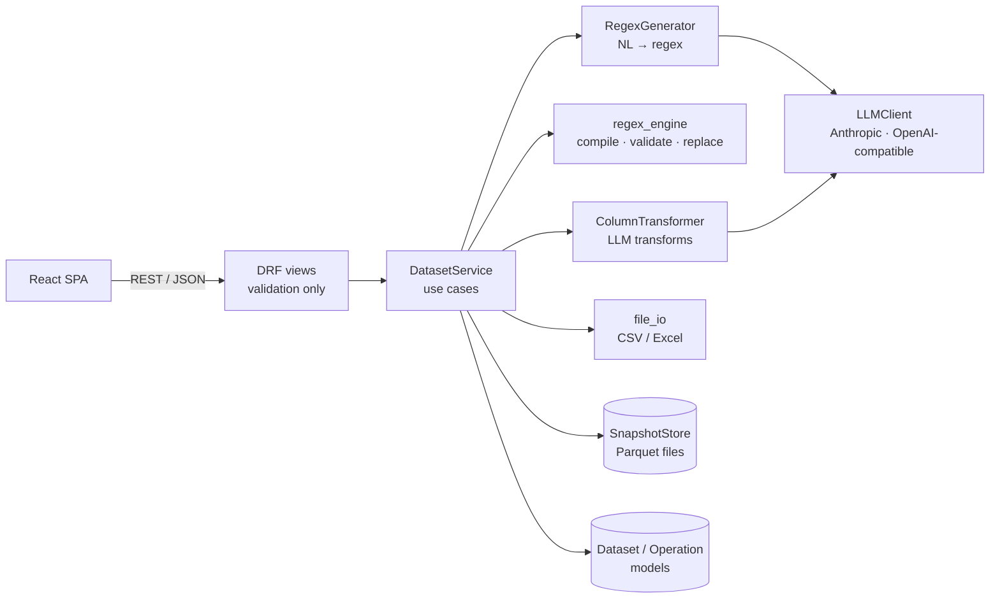

# Pattern Replace

Upload a CSV or Excel file, describe a pattern in plain English (“find email addresses”), and the app asks an LLM to write the regex. You can preview the result, adjust it, and replace the matches across the text columns. It is built with **Django + Django REST Framework** and **React (Vite)**.

**Live demo:** `https://pattern-replace.onrender.com` 

## Demo video


_Video goes here._

https://github.com/user-attachments/assets/e41858f8-4c62-42c2-a31e-fb88713d2c83


---

## What it does

| Step | Detail |
| --- | --- |
| Upload | CSV, TSV, XLSX or XLS, up to 50 MB and 1M rows (both configurable). The upload shows a progress bar. The app detects the delimiter (`,` `;` tab `\|`) and the encoding (UTF-8, CP1252, Latin-1). Blank and duplicate headers are fixed automatically. |
| Describe | You describe the pattern in natural language. You can optionally choose target columns and a replacement value. If the sentence already names both, as in “…in the Email column and replace them with 'REDACTED'”, the LLM extracts them for you. |
| Review | The generated regex is shown with colour-coded syntax and a one-sentence explanation. Next to it are the match counts and before/after examples from a dry run. You can edit the regex or toggle its flags and preview again. |
| Replace | The table refreshes and the changed cells are highlighted. |
| History | Every change is listed. You can undo the last change or restore the original file at any time. |
| Export | Download the current version as CSV or Excel. |
| AI transforms (optional) | **Clean up a column** rewrites the values in place, for example “convert every date to YYYY-MM-DD”. **Add a derived column** creates a new column from an existing one, for example “classify the note as complaint, question or other”. |

The brief’s example scenario works end to end in one request. It is also covered by a test (`RegexFlowTests.test_brief_scenario_in_one_request`).

---

## Architecture



```
backend/
  config/                  settings (12-factor, env driven), urls, wsgi
  processor/
    models.py              Dataset, Operation (history + audit trail)
    exceptions.py          domain errors -> mapped to HTTP status codes
    api/                   serializers, views, urls, uniform error handler, SPA fallback
    services/
      llm.py               provider-agnostic LLM client + robust JSON parsing
      regex_generation.py  prompt, validation, self-correction loop
      regex_engine.py      safe compile/replace with per-cell timeouts
      transforms.py        the two LLM transformations
      file_io.py           reading, profiling and exporting tables
      storage.py           immutable Parquet snapshots with an LRU cache
      datasets.py          application service used by the views
    management/commands/purge_datasets.py
    tests/                 unit tests (pure services) + API integration tests
frontend/
  src/api/client.js        fetch wrapper, uniform ApiError, upload progress via XHR
  src/hooks/useDataset.js  dataset + page state, URL sync (?dataset=<id>)
  src/components/          UploadScreen, FindReplacePanel, RegexPattern, PreviewSamples,
                           TransformPanel, HistoryList, DataTable, Toolbar, Notice
```

### Key design decisions

1. **Thin views, framework-free core.** The regex engine, the LLM prompt logic, the transforms and the file parsing never import Django, so they can be unit tested in isolation. Views only validate input, call a single `DatasetService` method and serialise the result. The services raise typed domain errors (`PatternError`, `LLMError`, …). One exception handler turns those errors into `{"error": {"code", "message", "details"}}` with the right status code.
2. **Immutable snapshots plus an operation log.** The upload and the result of every operation are each written once as a Parquet file. The current state is the latest operation’s snapshot. Undo means deleting the last operation, and reset means deleting all of them. Changed cells are found by diffing against the previous snapshot. Because snapshots never change, they can be cached in memory safely, so paging through a large table only parses the file once.
3. **Everything is read as text.** Cells are loaded as strings, so values like `00123`, `1.50` and phone numbers survive a round trip unchanged. Each column is still profiled as text, numeric or empty. By default the app targets only text columns, as the brief asks, but you can pick any column explicitly.
4. **The LLM is untrusted input.** Generated patterns are compiled, length-limited and checked for zero-width matches before they run. Every match also runs under a per-cell timeout (`regex` module) and an overall time budget, so a catastrophically backtracking pattern cannot hang a worker. Replacement values are inserted **literally** unless you enable group references, so a value like `C:\new` cannot be misread as a template.
5. **Pluggable LLM provider.** `LLMClient` has one method. The app ships with Anthropic and OpenAI-compatible adapters, which also cover Groq, Together, OpenRouter and a local Ollama server. Tests use a scripted `FakeLLM`.

### How the regex generation stays accurate

The requirement is to “handle various natural language descriptions accurately”. `RegexGenerator` does that in four steps:

- **Grounding.** The prompt lists each column’s name, inferred type and up to five distinct sample values. That way “order numbers” can be matched to the format the data actually uses. Set `LLM_SEND_SAMPLE_VALUES=false` if the data must not leave the server.
- **Structured output.** The model must return a JSON object with `pattern`, `flags`, `columns`, `replacement` and `explanation`, guided by a few worked examples. The output is parsed leniently: Markdown fences and surrounding prose are stripped.
- **Validate, then self-correct.** Invalid JSON, a regex that does not compile, unknown flags, columns that don’t exist and empty or zero-width matches are all sent back to the model as feedback, up to three attempts in total.
- **Sanity check against the data.** If a valid pattern matches *none* of the sample values in its target columns, the model is asked once to double-check. Its second answer is accepted either way, because finding no matches can be legitimate.

The user always sees the regex and a dry-run preview before anything changes, and can edit it by hand.

### The two LLM transformations

Both send the column’s **distinct** non-empty values to the LLM in batches of `{"id", "value"}` items. The model answers by id, so a model that normalises whitespace cannot break the mapping. Ids the model skips are retried once. Any value still missing keeps its original content (for a clean-up) or stays empty (for a new column), and the result reports how many were affected. The cost therefore scales with the number of distinct values, not with the number of rows. The limit is 500 distinct values by default (`TRANSFORM_MAX_UNIQUE_VALUES`).

### Large files

- Uploads larger than 5 MB are streamed to disk rather than held in memory, and Parquet snapshots keep memory use and reload time low.
- The table is paginated on the server (up to 500 rows per page), so the browser never receives the whole file.
- Replacements are computed once per distinct value and then mapped back onto the column.
- Not done yet (see *Future work*): background jobs for multi-minute operations.

---

## API

All endpoints are under `/api/`. Errors always look like `{"error": {"code": "invalid_pattern", "message": "...", "details": ...}}`.

| Method | Path | Purpose |
| --- | --- | --- |
| GET | `/health/` | Liveness check and LLM configuration status (never includes secrets) |
| POST | `/datasets/` | Upload a file (`multipart/form-data`, field `file`) |
| GET / DELETE | `/datasets/{id}/` | Metadata, columns and history / delete |
| GET | `/datasets/{id}/rows/?page=1&page_size=50&highlight=true` | One page of rows, plus `changed` cells as `[row, col]` |
| GET | `/datasets/{id}/export/?format=csv\|xlsx` | Download the current version |
| POST | `/datasets/{id}/regex/suggest/` | `{instruction, columns?, replacement?}` → `{suggestion, preview}` |
| POST | `/datasets/{id}/regex/preview/` | Dry-run `{pattern, flags, replacement, columns, use_backrefs}` |
| POST | `/datasets/{id}/regex/apply/` | Apply. Accepts either a `pattern` or **only an `instruction`**, in which case the LLM generates the regex in the same request |
| POST | `/datasets/{id}/transform/` | `{kind: "standardize" \| "derive", column, instruction, new_column?}` |
| POST | `/datasets/{id}/undo/` · `/reset/` | History |

One-shot example matching the brief:

```bash
curl -F file=@people.csv http://localhost:8000/api/datasets/
curl -X POST http://localhost:8000/api/datasets/<id>/regex/apply/ \
  -H 'Content-Type: application/json' \
  -d '{"instruction": "Find email addresses in the Email column and replace them with '\''REDACTED'\''."}'
```

---

## Running locally

Prerequisites: Python 3.11 or newer, Node 18 or newer, and an API key for Anthropic or for any OpenAI-compatible provider.

```bash
# 1. Backend
cd backend
python -m venv .venv && source .venv/bin/activate   # Windows: .venv\Scripts\activate
pip install -r requirements.txt
cp .env.example .env            # then set LLM_API_KEY (and LLM_PROVIDER / LLM_MODEL if needed)
python manage.py migrate
python manage.py runserver      # http://127.0.0.1:8000

# 2. Frontend (second terminal)
cd frontend
npm install
npm run dev                     # http://localhost:5173  (proxies /api to :8000)
```

On the first screen, the *Try the sample contacts file* button loads the brief’s example data plus a few extra rows with phone numbers, dates and links.

### With Docker (production-like, single container)

```bash
docker build -t pattern-replace .
docker run -p 8000:8000 -e DJANGO_SECRET_KEY=change-me -e DJANGO_ALLOWED_HOSTS=localhost \
  -e LLM_API_KEY=sk-... pattern-replace
# open http://localhost:8000
```

The image builds the React app and Django serves it through WhiteNoise, so the frontend and the API share one origin and no CORS setup is needed.

### Tests

```bash
cd backend && python manage.py test
```

The suite contains unit tests for the regex engine, the regex generator (including the self-correction and grounding loops) and the transforms, all using a fake LLM, plus file parsing and API integration tests. GitHub Actions (`.github/workflows/ci.yml`) runs the tests, `manage.py check`, a missing-migrations check and the frontend build.

---

## Deployment (Render, free tier)

1. Push the repository to GitHub.
2. On Render, choose **New → Blueprint** and select the repository. `render.yaml` defines a single Docker web service.
3. Enter `LLM_API_KEY` when prompted. Optionally set `LLM_PROVIDER` and `LLM_MODEL`.
4. Once the deploy finishes, open `https://<service>.onrender.com`. `/api/health/` should report `"configured": true`.

Notes: the free tier sleeps when idle, so the first request takes about 30 seconds, and its disk is ephemeral, so uploads disappear on redeploy. That is acceptable for a demo. For persistence, attach a Render Disk and set `DATA_DIR`, and set `DATABASE_URL` to use Postgres. The same image also runs on Fly.io, Railway or Cloud Run without changes.

Optional cleanup job: `python manage.py purge_datasets --hours 24`.

## Configuration

All settings are environment variables; see `backend/.env.example`.

| Variable | Default | Purpose |
| --- | --- | --- |
| `LLM_PROVIDER` | `anthropic` | `anthropic` or `openai` (any OpenAI-compatible API) |
| `LLM_API_KEY` | – | Provider key. `ANTHROPIC_API_KEY` / `OPENAI_API_KEY` are also read |
| `LLM_MODEL` | provider default | Model id, see `DEFAULT_MODELS` in `services/llm.py` |
| `LLM_BASE_URL` | – | For OpenAI-compatible providers, e.g. `https://api.groq.com/openai/v1` |
| `LLM_SEND_SAMPLE_VALUES` | `true` | Send a few cell values to the LLM as context |
| `MAX_UPLOAD_SIZE_MB` / `MAX_ROWS` | `50` / `1000000` | Upload limits |
| `REGEX_CELL_TIMEOUT_SECONDS` | `0.5` | Per-cell regex timeout |
| `OPERATION_TIME_BUDGET_SECONDS` | `90` | Overall time limit for one replacement |
| `TRANSFORM_MAX_UNIQUE_VALUES` / `TRANSFORM_BATCH_SIZE` | `500` / `40` | Limits for the LLM transforms |
| `DATABASE_URL` | SQLite | e.g. a Postgres URL |
| `DATA_DIR` | `backend/data` | Uploads and snapshots |

---

## Limitations and future work

- **Background jobs.** Replacements and transforms run inside the request, and the timeouts keep that safe. Very large files would be better served by a job queue (Celery or RQ) with progress polling.
- **Accounts.** The app is anonymous by design. Datasets are addressed by random UUIDs, and the `?dataset=` link reopens a table. Multi-user deployments would add authentication and per-user ownership.
- **Excel specifics.** Only the first sheet is read, formulas are imported as their computed values, and the export writes plain values.
- **Regex dialect.** Patterns use Python `regex` syntax, which is a superset of `re`. JavaScript-only syntax is rejected with a clear error, and the LLM gets that error as feedback.
- **Privacy.** When sample values are enabled, a few cells per column are sent to the LLM provider. Turn this off for sensitive data.
